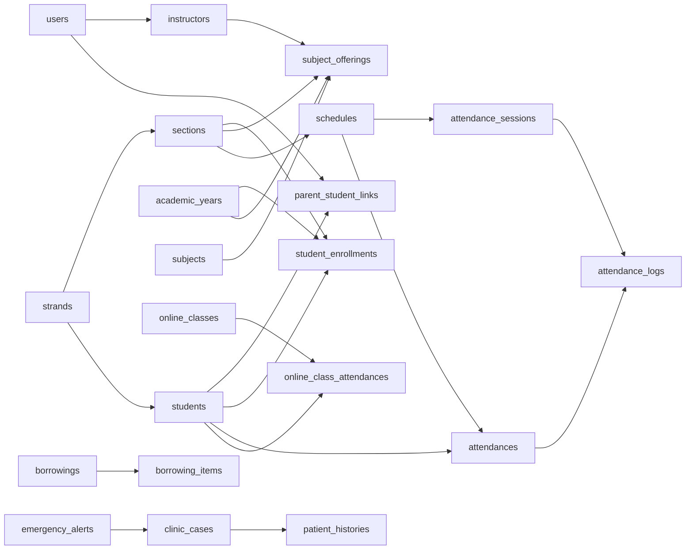

# Database Relationship Reference

This is the canonical connection map for the final schema produced by every migration in `database/migrations` as of 2026-10-11. It distinguishes database-enforced foreign keys from application-level links. That distinction matters: an application-level link can be joined by Laravel, but the database will not prevent an orphaned value.

`CASCADE` deletes dependent rows, `SET NULL` preserves the dependent row and clears its reference, and `RESTRICT/default` blocks hard deletion while a dependent row exists. Soft deletion only fills `deleted_at`; it does not execute a foreign-key delete action.

## High-level relationship map

Role-specific Messenger switches and the Student excuse-letter Messenger visibility switch are key/value rows in `system_settings` and add no database relationship. Automated excuse notifications reuse the existing `student_portal_messages` recipient and letter foreign keys; Student notification delivery remains independent of whether those updates appear in Messenger.

The diagram shows the main business path only. The tables below are exhaustive for migration-declared foreign keys and known migration-declared logical links.

## Enforced foreign keys

### Identity and academic structure

| Child column | Parent column | Nullable | On parent hard delete | Meaning |
| --- | --- | --- | --- | --- |
| `sections.strand_id` | `strands.strand_id` | No | RESTRICT/default | Strand that owns the Section. |
| `students.section_id` | `sections.section_id` | Yes | RESTRICT/default | Compatibility/current Section placement. |
| `students.strand_id` | `strands.strand_id` | Yes | RESTRICT/default | Compatibility/current Strand placement. |
| `instructors.user_id` | `users.user_id` | No | CASCADE | Account behind the Instructor profile. |
| `instructors.strand_id` | `strands.strand_id` | No | RESTRICT/default | Instructor department/Strand. |
| `subjects.section_id` | `sections.section_id` | Yes | SET NULL | Legacy Section assignment. |
| `subjects.user_id` | `users.user_id` | Yes | SET NULL | Legacy Instructor-user assignment. |
| `academic_years.activated_by_user_id` | `users.user_id` | Yes | SET NULL | Actor that activated the year. |
| `academic_years.closed_by_user_id` | `users.user_id` | Yes | SET NULL | Actor that closed the year. |
| `academic_years.reopened_by_user_id` | `users.user_id` | Yes | SET NULL | Actor that reopened the year. |
| `student_enrollments.student_id` | `students.student_id` | No | CASCADE | Permanent Student identity. |
| `student_enrollments.academic_year_id` | `academic_years.academic_year_id` | No | RESTRICT | Enrollment year. |
| `student_enrollments.section_id` | `sections.section_id` | No | RESTRICT | Historical Section placement. |
| `student_enrollments.strand_id` | `strands.strand_id` | No | RESTRICT | Historical Strand placement. |
| `subject_offerings.academic_year_id` | `academic_years.academic_year_id` | No | RESTRICT | Offering year. |
| `subject_offerings.subject_id` | `subjects.subject_id` | No | RESTRICT | Reusable Subject catalog row. |
| `subject_offerings.section_id` | `sections.section_id` | No | RESTRICT | Section receiving the Subject. |
| `subject_offerings.instructor_id` | `instructors.instructor_id` | Yes | SET NULL | Assigned Instructor profile. |
| `schedules.section_id` | `sections.section_id` | No | RESTRICT/default | Section scheduled for the class. |

### Academic-year rollover

| Child column | Parent column | Nullable | On parent hard delete | Meaning |
| --- | --- | --- | --- | --- |
| `academic_year_rollovers.source_academic_year_id` | `academic_years.academic_year_id` | No | RESTRICT | Source year. |
| `academic_year_rollovers.destination_academic_year_id` | `academic_years.academic_year_id` | No | RESTRICT | Destination year. |
| `academic_year_rollovers.executed_by_user_id` | `users.user_id` | Yes | SET NULL | User that executed the rollover. |
| `academic_year_rollover_items.academic_year_rollover_id` | `academic_year_rollovers.academic_year_rollover_id` | No | CASCADE | Parent rollover audit. |
| `academic_year_rollover_items.student_id` | `students.student_id` | Yes | RESTRICT | Student decision target. |
| `academic_year_rollover_items.source_student_enrollment_id` | `student_enrollments.student_enrollment_id` | Yes | RESTRICT | Enrollment copied from. |
| `academic_year_rollover_items.destination_student_enrollment_id` | `student_enrollments.student_enrollment_id` | Yes | RESTRICT | Enrollment created/selected. |
| `academic_year_rollover_items.destination_section_id` | `sections.section_id` | Yes | RESTRICT | Destination Section. |

### Physical attendance and panel devices

| Child column | Parent column | Nullable | On parent hard delete | Meaning |
| --- | --- | --- | --- | --- |
| `attendance_sessions.schedule_id` | `schedules.scheduled_id` | Yes | SET NULL | Schedule that opened the room session. |
| `attendances.student_id` | `students.student_id` | No | RESTRICT/default | Student owning the official result. |
| `attendances.schedule_id` | `schedules.scheduled_id` | Yes | SET NULL | Scheduled class for the result. |
| `attendance_logs.attendance_id` | `attendance_sessions.attendance_id` | No | CASCADE | Room session containing the tap. |
| `attendance_logs.main_attendance_id` | `attendances.attendance_id` | Yes | SET NULL | Official Student result affected by the tap. |
| `attendance_logs.student_id` | `students.student_id` | Yes | SET NULL | Student that tapped. |
| `attendance_logs.schedule_id` | `schedules.scheduled_id` | Yes | SET NULL | Schedule context captured for the tap. |
| `rfid_panel_sessions.schedule_id` | `schedules.scheduled_id` | Yes | SET NULL | Schedule selected by the live Console. |
| `rfid_panel_sessions.opened_by_user_id` | `users.user_id` | Yes | SET NULL | User that opened the panel session. |
| `panel_devices.laboratory_id` | `laboratories.laboratory_id` | Yes | SET NULL | Room assigned to a managed panel; the column is also unique. |

### Online classes

| Child column | Parent column | Nullable | On parent hard delete | Meaning |
| --- | --- | --- | --- | --- |
| `online_classes.created_by_user_id` | `users.user_id` | Yes | SET NULL | Creator audit actor. |
| `online_classes.updated_by_user_id` | `users.user_id` | Yes | SET NULL | Last update actor. |
| `online_classes.cancelled_by_user_id` | `users.user_id` | Yes | SET NULL | Cancellation actor. |
| `online_class_attachments.online_class_id` | `online_classes.online_class_id` | No | CASCADE | Attachment owner. |
| `online_class_attendances.online_class_id` | `online_classes.online_class_id` | No | CASCADE | Class joined by the Student. |
| `online_class_attendances.student_id` | `students.student_id` | No | CASCADE | Student join result. |
| `online_class_notifications.online_class_id` | `online_classes.online_class_id` | No | CASCADE | Class that produced the notification. |
| `online_class_notifications.student_id` | `students.student_id` | No | CASCADE | Notification recipient. |
| `online_class_audit_logs.online_class_id` | `online_classes.online_class_id` | Yes | SET NULL | Audited class. |
| `online_class_audit_logs.user_id` | `users.user_id` | Yes | SET NULL | Audit actor. |
| `online_class_audit_logs.section_id` | `sections.section_id` | Yes | SET NULL | Section context. |

### Messaging, portals, and excuse letters

| Child column | Parent column | Nullable | On parent hard delete | Meaning |
| --- | --- | --- | --- | --- |
| `messages.instructor_user_id` | `users.user_id` | No | CASCADE | Instructor inbox owner. |
| `parent_student_links.parent_user_id` | `users.user_id` | No | CASCADE | Parent account. |
| `parent_student_links.student_id` | `students.student_id` | No | CASCADE | Linked Student. |
| `excuse_letters.user_id` | `users.user_id` | No | CASCADE | Submitter account in the legacy workflow. |
| `excuse_letters.student_id` | `students.student_id` | Yes | SET NULL | Student named by the legacy letter. |
| `excuse_letters.reviewed_by_user_id` | `users.user_id` | Yes | SET NULL | Legacy reviewer. |
| `student_excuse_letters.student_id` | `students.student_id` | No | CASCADE | Student named by the portal letter. |
| `student_excuse_letters.submitted_by_user_id` | `users.user_id` | No | CASCADE | Student/Parent submitter. |
| `student_excuse_letters.parent_approved_by_user_id` | `users.user_id` | Yes | SET NULL | Approving Parent account. |
| `student_portal_messages.student_id` | `students.student_id` | Yes | CASCADE | Optional Student conversation context. |
| `student_portal_messages.sender_user_id` | `users.user_id` | No | CASCADE | Message sender. |
| `student_portal_messages.recipient_user_id` | `users.user_id` | Yes | SET NULL | Direct recipient. |
| `student_portal_messages.instructor_user_id` | `users.user_id` | Yes | SET NULL | Compatibility Instructor recipient. |
| `student_portal_messages.student_excuse_letter_id` | `student_excuse_letters.student_excuse_letter_id` | Yes | SET NULL | Generated/delivered letter represented by the message. |
| `student_portal_messages.excuse_letter_reviewed_by_user_id` | `users.user_id` | Yes | SET NULL | Instructor that decided this delivery. |

### Inventory, emergency, Clinic, and auditing

| Child column | Parent column | Nullable | On parent hard delete | Meaning |
| --- | --- | --- | --- | --- |
| `borrowings.student_id` | `students.student_id` | Yes | SET NULL | Student borrower. |
| `borrowings.user_id` | `users.user_id` | Yes | SET NULL | Instructor/user borrower. |
| `borrowing_items.borrowing_id` | `borrowings.borrowing_id` | No | CASCADE | Borrowing header. |
| `inventories.item_id` | `items.item_id` | No | CASCADE | Legacy item quantity. |
| `transactions.inventory_id` | `inventories.inventory_id` | No | CASCADE | Legacy inventory record. |
| `transactions.item_id` | `items.item_id` | No | RESTRICT | Legacy item moved by the transaction. |
| `emergency_alerts.emergency_type_id` | `emergency_types.emergency_type_id` | Yes | SET NULL | Configured alert type. |
| `emergency_alerts.triggered_by_user_id` | `users.user_id` | Yes | SET NULL | Triggering account. |
| `emergency_alerts.schedule_id` | `schedules.scheduled_id` | Yes | SET NULL | Class context. |
| `clinic_cases.emergency_alert_id` | `emergency_alerts.emergency_alert_id` | Yes | SET NULL | Alert dispatched into the case. |
| `clinic_cases.student_id` | `students.student_id` | Yes | SET NULL | Student patient. |
| `clinic_cases.user_id` | `users.user_id` | Yes | SET NULL | Non-Student patient account. |
| `clinic_cases.handled_by_user_id` | `users.user_id` | Yes | SET NULL | Clinic handler. |
| `patient_histories.student_id` | `students.student_id` | Yes | SET NULL | Student patient. |
| `patient_histories.user_id` | `users.user_id` | Yes | SET NULL | Non-Student patient account. |
| `patient_histories.recorded_by_user_id` | `users.user_id` | Yes | SET NULL | Clinic recorder. |
| `patient_histories.clinic_case_id` | `clinic_cases.clinic_case_id` | Yes | SET NULL | Source case; unique, so one case can create at most one linked history row. |
| `registrar_enrollment_logs.registrar_user_id` | `users.user_id` | Yes | SET NULL | Registrar audit actor. |
| `activity_logs.user_id` | `users.user_id` | Yes | SET NULL | General audit actor. |

### Root ownership

| Child column | Parent column | Nullable | On parent hard delete | Meaning |
| --- | --- | --- | --- | --- |
| `root_transfer_requests.from_user_id` | `users.user_id` | No | RESTRICT | Current owner. |
| `root_transfer_requests.to_user_id` | `users.user_id` | No | RESTRICT | Proposed owner. |
| `root_transfer_requests.requested_by` | `users.user_id` | No | RESTRICT | Request actor. |
| `root_override_requests.requester_id` | `users.user_id` | No | RESTRICT | Override requester. |
| `root_override_requests.from_user_id` | `users.user_id` | No | RESTRICT | Current owner. |
| `root_override_requests.to_user_id` | `users.user_id` | No | RESTRICT | Proposed owner. |
| `root_override_approvals.root_override_request_id` | `root_override_requests.id` | No | CASCADE | Override being decided. |
| `root_override_approvals.approver_id` | `users.user_id` | No | RESTRICT | Approving/rejecting Admin. |
| `root_audit_logs.actor_id` | `users.user_id` | Yes | SET NULL | Audit actor. |
| `root_audit_logs.target_user_id` | `users.user_id` | Yes | SET NULL | User affected by the event. |
| `root_audit_logs.root_transfer_request_id` | `root_transfer_requests.id` | Yes | SET NULL | Related transfer. |
| `root_audit_logs.root_override_request_id` | `root_override_requests.id` | Yes | SET NULL | Related override. |

## Logical links without database foreign keys

These columns are intentional application-level connections in the migrations. Validation, service logic, and tests—not a foreign-key constraint—must protect them.

| Column(s) | Logical target | Notes |
| --- | --- | --- |
| `sessions.user_id` | `users.user_id` | Indexed Laravel session owner, but no FK. |
| `sections.academic_year_id` | `academic_years.academic_year_id` | Used for year scoping and uniqueness; nullable and not constrained. |
| `schedules.academic_year_id` | `academic_years.academic_year_id` | Historical/current year context. |
| `schedules.subject_offering_id` | `subject_offerings.subject_offering_id` | Main normalized class assignment. |
| `schedules.laboratory_id` | `laboratories.laboratory_id` | Physical room assignment. |
| `schedules.instructor_id` | `instructors.instructor_id` | Denormalized assignment synchronized from the offering. |
| `schedules.subject_code` | `subjects.subject_code` | Compatibility label, not a primary-key reference. |
| `attendance_sessions.academic_year_id`, `subject_offering_id` | `academic_years`, `subject_offerings` | Captured class context. |
| `attendances.subject_id` | `subjects.subject_id` | Nullable Subject context. |
| `attendances.academic_year_id`, `subject_offering_id`, `student_enrollment_id` | `academic_years`, `subject_offerings`, `student_enrollments` | Historical attendance context. |
| `attendance_logs.academic_year_id`, `subject_offering_id`, `student_enrollment_id` | `academic_years`, `subject_offerings`, `student_enrollments` | Tap-time context. |
| `rfid_panel_sessions.academic_year_id`, `subject_offering_id` | `academic_years`, `subject_offerings` | Live Console context. |
| `online_classes.schedule_id`, `academic_year_id`, `subject_offering_id`, `instructor_id`, `section_id` | `schedules`, `academic_years`, `subject_offerings`, `instructors`, `sections` | Assignment columns are indexed/queried but not constrained. `instructor_id` is nullable. |
| `online_class_attendances.academic_year_id`, `subject_offering_id`, `student_enrollment_id` | `academic_years`, `subject_offerings`, `student_enrollments` | Join-time academic context. |
| `online_class_notifications.academic_year_id`, `subject_offering_id`, `student_enrollment_id` | `academic_years`, `subject_offerings`, `student_enrollments` | Recipient academic context. |
| `student_excuse_letters.academic_year_id`, `student_enrollment_id` | `academic_years`, `student_enrollments` | Submission context. |
| `student_excuse_letters.recipient_user_ids` | Multiple `users.user_id` values | JSON array; no row-level FK enforcement. |
| `borrowings.item_id`, `borrowing_items.item_id` | `inventory_items.item_id` | Current borrowing workflow link. Both columns are indexed or carried as IDs, but neither has an FK. |
| `registrar_enrollment_logs.person_type` + `person_id` | `students` or `instructors` | Polymorphic audit reference. |
| `activity_logs.subject_type` + `subject_id` | Any audited model | Polymorphic audit reference. |

## Tables without application foreign keys

`password_reset_tokens`, `cache`, `cache_locks`, `system_settings`, `emergency_hotlines`, `legacy_academic_fallback_events`, `jobs`, and `failed_jobs` are standalone. The `migrations` table is maintained by Laravel. `items`, `inventory_items`, `laboratories`, `strands`, `users`, `emergency_types`, and `academic_years` are parent/master tables even when they do not point outward.

## Change checklist

When adding or changing a relationship:

1. Decide explicitly whether it must be an enforced FK or a documented logical link.
2. Define nullability, index/uniqueness, and hard-delete behavior.
3. Account for soft deletion separately from hard deletion.
4. Update this file, `DATABASE_SCHEMA_REFERENCE.md`, and page/workflow documentation affected by the relationship.
5. Add or update migration and relationship tests.
6. Run `php artisan test` as required by the repository AI instructions.

